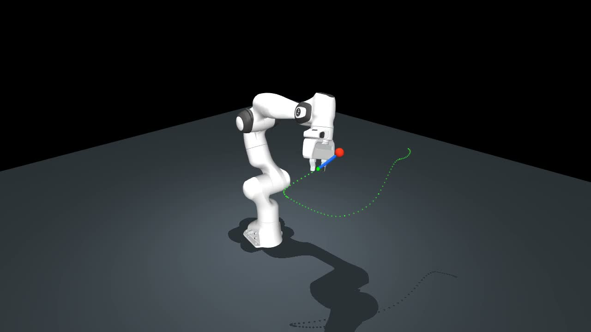
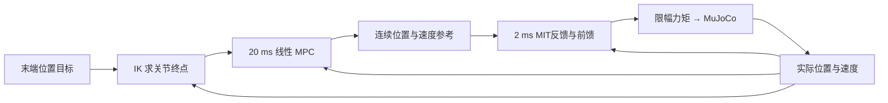
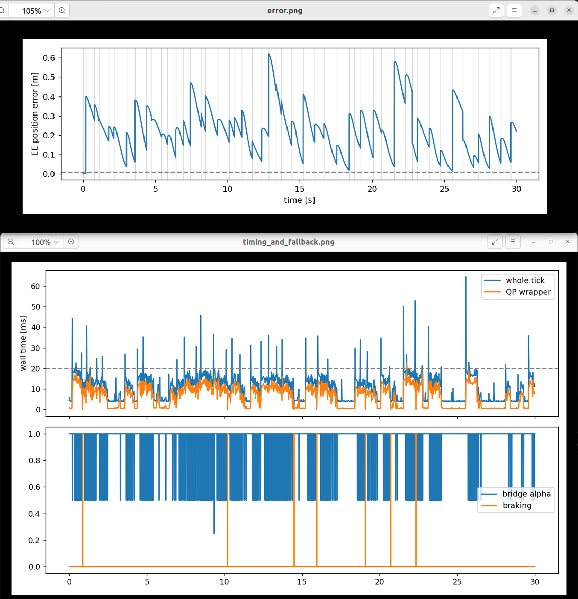
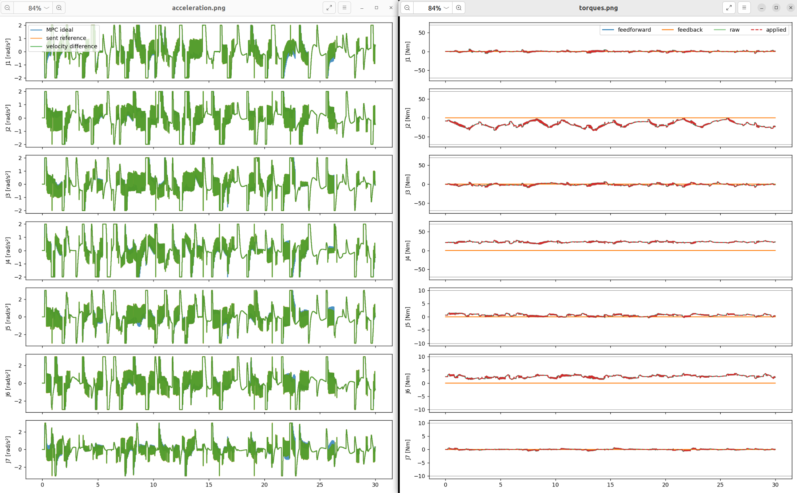

# Panda 机械臂 MPC 控制教程

[](https://github.com/zhangfuyong888/franka_mpc/actions/workflows/tutorial.yml)

从单关节预测控制开始，逐步实现七轴 Panda 的末端目标跟踪、途中换目标和扰动恢复。
使用 Python、MuJoCo、mink 和 OSQP，重点解释**模型怎样写、约束怎样加入、优化结果怎样变成真实运动**。

[](docs/media/demo.mp4)

[观看或下载 30 秒 MP4 演示](docs/media/demo.mp4)。GitHub 若未内嵌播放，可下载到本地观看。
演示为快速随机目标替换，不要求机械臂在每次切换前到达；它不是固定目标精度或实时性证明。

## 你会实现什么



这是**关节空间加速度级线性 MPC**：上层用双积分模型规划，下层以关节阻抗和名义动力学前馈产生力矩。
不是完整动力学 NMPC；当前任务是离散位置目标到达和替换，不含连续目标轨迹预瞄、参数自适应、全局绕障或真机通信。
需要基本 Python、向量/矩阵及机器人关节概念；不要求先熟悉 MPC。

## 先跑通第一课

推荐 Ubuntu 22.04、Python 3.10。GitHub Actions 已在 Python 3.10 和 3.11 上通过在线安装、
自动测试，以及独立环境中的 wheel 安装和第一课运行；EGL 离屏渲染与视频测试也已通过。
代码声明支持 Python 3.10～3.12，3.12 尚未验证。具体提交、结果与平台边界见 [验证记录](docs/validation.md)。

```bash
git clone https://github.com/zhangfuyong888/franka_mpc.git
cd franka_mpc
python3.10 -m venv .venv
source .venv/bin/activate
python -m pip install -c requirements/constraints-py310-linux.txt -e '.[test]'
python -m pip check
python -m panda_mpc.doctor

# 第一课：不需要桌面显示、视频编码器或 GPU 渲染
python -m panda_mpc.demo --config configs/tutorial/01_single_target.yaml --headless
```

若创建环境时提示缺少 `ensurepip`，Ubuntu 可先安装 `python3.10-venv`。
已有环境不要覆盖；也可使用 [安装脚本](scripts/install.sh)，如
`PYTHON=python3.10 VENV_DIR=.venv-tutorial bash scripts/install.sh`，脚本拒绝覆盖已有目录。
版本约束覆盖 Python 3.10 环境的依赖闭包，已在 GitHub Actions 中验证在线安装。
Python 3.11 可省略 `-c requirements/constraints-py310-linux.txt`，按 `pyproject.toml` 安装；约束文件不是带下载文件哈希的锁文件。

**预期结果**：终端显示 `Final goal: reached`，位置误差小于 0.01 m；默认基线原有结果约 0.000859 m，
数值受环境影响，不要求逐位相同。正常结束后自动保存六张图、`summary.json` 和易读的 `report.md`。
模型、网格和原许可随包提供，启动不下载模型。

## 按这个顺序学习

| 阶段 | 运行入口 | 主要观察 |
|---|---|---|
| FK 与 IK | `python examples/01_fk_ik.py` | seed、关节终点、FK 位置误差 |
| 单关节 MPC | `python examples/02_single_joint_mpc.py` | 自动生成位置/速度/加速度图 |
| MIT 力矩执行 | `python examples/03_mit_step.py` | 自动生成实际/参考、误差与力矩图 |
| 固定末端目标 | `--config configs/tutorial/01_single_target.yaml` | 实际状态能否跟随参考并停稳 |
| 固定目标切换 | `--config configs/tutorial/02_switch.yaml` | 新目标立即生效，运动状态保持连续 |
| 单参数对照 | `--config configs/tutorial/04_smooth_mpc.yaml` | 增大加速度变化惩罚后怎样变化 |
| 随机快速抢占 | `--config configs/tutorial/03_rapid_analysis.yaml` | 半速、大空间、回退和制动；不录制 |
| 外力恢复 | `--scenario disturbance --duration 12` | 有/无扰动对照、偏移和恢复 |

表中配置参数用于 `python -m panda_mpc.demo`，无桌面时添加 `--headless`。
每课的完整命令、预期现象和练习见 [实验路线](docs/lessons.md)。

详细阅读顺序：[架构](docs/architecture.md) → [控制数学](docs/control_math.md) → [实验与验证](docs/validation.md)。
数学文档对应真实代码，包含单关节两步 QP 数值例子；明确区分实测状态、MPC 预测和下发参考。

## 怎样看运行过程

每次输出到新的 `outputs/时间戳-场景/`，终端会打印实际路径。先打开 `report.md`，再看 `plots/`。
`events.json` 记录目标和降级原因，`ticks.json` 记录每次 MPC，`telemetry.npz` 记录每 2 ms 的实际/参考/力矩。
`resolved_config.yaml` 是本次真正使用的配置；元数据包含源码哈希、Git 提交号、未提交标志和日志版本。

```bash
# 用本次实际输出目录替换 outputs/my-run
python -m panda_mpc.analyze --run-dir outputs/my-run
# 定位某个时刻：保存 inspection.json 和 plots/inspection.png
python -m panda_mpc.analyze --run-dir outputs/my-run --at 0.86 --joint 2 --window 0.3
# 对照相同目标表、相同采样时刻的两个参数实验
python -m panda_mpc.analyze --run-dir outputs/candidate --against outputs/baseline
```

新摘要区分**输入状态拒绝、QP 求解器失败、解复核拒绝、预测接触拒绝和参考回退**。
旧 `qp_failures` 字段为兼容保留，历史含义是所有 MPC 拒绝，不宜单独当作求解器失败数。
`--compare` 专用于有/无扰动对照，`--against` 用于控制参数对照。
默认优化器对速度/加速度留 0.1% 内部裕量，并复核原始操作界，避免数值微小越界造成不必要的拒绝；实测状态不裁剪。

<details>
<summary>查看示例：误差、耗时与参考回退</summary>



误差的竖直变化常来自目标替换；alpha 是参考候选的回退比例，不是新旧目标权重。
`braking` 表示显式制动，和 alpha 不是同一个状态。

</details>

<details>
<summary>查看示例：加速度与关节力矩</summary>



理想加速度、下发参考及实测速度差分是不同的量；力矩图用来检查前馈、反馈及总限幅。
这些是仓库提供的展示素材，准确实验参数应查对应运行的解析配置，不从截图推断。

</details>

## 演示与视频录制

桌面启动时去掉 `--headless`。原有个人演示配置保持半速、随机快速切换和自动录制：

```bash
python -m pip install -e '.[video]'
python -m panda_mpc.demo --config configs/rapid_switch.yaml --duration 30
```

保存 `simulation.mp4`（H.264 Main / yuv420p，1280×720、30 FPS），该配置另生成 VP9 WebM。
固定斜侧相机距离 1.8 m，展示最近四条已结束轨迹和当前轨迹；窗口拖动不改变视频取景。
不想录制可加 `--no-record-video`。无桌面录制须有 EGL：

```bash
MUJOCO_GL=egl python -m panda_mpc.doctor --video --render
MUJOCO_GL=egl python -m panda_mpc.demo --config configs/rapid_switch.yaml --duration 30 --headless
```

FFmpeg 可来自 `PANDA_MPC_FFMPEG`、PATH、可选 imageio-ffmpeg 包或当前 Conda 安装已有环境。
普通不录制 headless 路径不创建渲染器。录制会增加墙钟耗时，性能比较应统一关闭。
Ubuntu 自带播放器缺 H.264 插件时可安装 `gstreamer1.0-libav`；无默认播放器时可安装 Totem。

## 验证与复用

```bash
python -m pytest -q -W error -m 'not video'
python scripts/check_docs.py
python scripts/acceptance.py
# 有网络时，从全新 venv 构建 wheel、安装依赖并跑测试/第一课
python scripts/verify_install.py
# 单独验证可选视频路径
MUJOCO_GL=egl python -m pytest -q -W error -m video
```

退出 0 表示正常结束，不保证目标到达；2 表示明确拒绝目标；1 为异常/监测停止；130 为中断。
输出目录必须不存在，防止覆盖实验。随机任务的正式参数对照建议用 `--events` 固定事件表；
固定 seed 不保证跨机器的 IK 墙钟预算和数值结果完全一致。

## GitHub Actions 自动检查什么

每次推送代码或提交 Pull Request，[自动验证工作流](.github/workflows/tutorial.yml) 都会在 GitHub 的临时 Ubuntu 环境运行：

- **Python 3.10 / 3.11**：安装依赖、检查环境和文档链接、运行非视频测试；再新建独立环境，构建和安装 wheel，运行测试及第一课。
- **视频路径**：检查 EGL 离屏渲染，并运行视频测试。
- **保存证据**：上传独立安装的日志、验证记录和第一课输出，供排查与复现。

在仓库的 [Actions 页面](https://github.com/zhangfuyong888/franka_mpc/actions) 查看结果，绿色勾表示该次检查通过。
打开某次运行，可查看失败步骤的日志，并在 Artifacts 下载 `lesson-results-py3.10` / `lesson-results-py3.11`。
也可选择 `Tutorial verification` → `Run workflow` 手动检查。它用于验证提交能否安装和运行，不会部署项目。

本项目是仿真教程，未提供硬实时、全局避障或真机安全保证。
[第三方声明](THIRD_PARTY_NOTICES.md) 保留模型和库的来源及许可，项目原创源码与文档采用 [MIT](LICENSE)，第三方模型与网格继续遵守其 Apache-2.0 许可。
[验证文档](docs/validation.md) 明确列出已运行结果、验证边界和历史证据。
