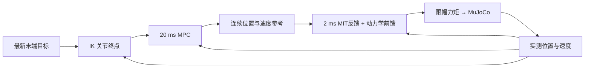

# Panda 在线目标跟踪仿真

本项目让七轴 Panda 机械臂追踪运行中出现的末端位置目标：用 IK（逆运动学）求关节终点，用线性 MPC（模型预测控制）安排后续运动，再通过连续参考和 MIT 形式的关节阻抗产生力矩，由 MuJoCo 仿真执行。新目标可以打断旧目标，实际位置和速度继续演化。



当前实现是离散目标点到达、运动途中换目标和外力恢复仿真；不含连续目标轨迹预瞄、在线参数自适应、全局绕障或真实机器人通信。模型、网格和许可随包提供，启动无需下载模型。

## 安装与启动

支持 Python 3.10～3.12。以下以 3.11 为例，在项目目录执行；若已有可用 `.venv`，直接激活即可。

```bash
python3.11 -m venv .venv
source .venv/bin/activate
python -m pip install -e '.[test]'
python -m pip check
```

主要依赖版本固定在 [pyproject.toml](pyproject.toml)。完整传递依赖锁及全新环境安装尚未验收；已有测试环境的情况见 [验证记录](docs/validation.md)。

```bash
# 固定目标、运动途中切换、随机目标：无窗口运行
python -m panda_mpc.demo --scenario single_target --headless --duration 10 --seed 42
python -m panda_mpc.demo --scenario switch --headless --duration 12 --seed 42
python -m panda_mpc.demo --scenario random --headless --duration 30 --seed 42

# 有桌面显示时，去掉 --headless 打开可视化
python -m panda_mpc.demo --scenario single_target --duration 10 --seed 42

# 外力实验；完整的同配置无扰动对照命令见验证文档
python -m panda_mpc.demo --scenario disturbance --headless --duration 12 --seed 42
```

`--duration` 是仿真秒数，到时自动结束。可用 `--config configs/default.yaml` 覆盖配置，用 `--output outputs/my-run` 指定尚不存在的输出目录，用 `--events configs/switch_events.json` 回放目标表。

## 查看结果

默认输出到 `outputs/时间戳-场景/`。先看终端的 `Final goal` 和 `EE error`，再看 `summary.json` 中的目标状态、饱和、QP 失败及计算耗时。`plots/error.png` 显示末端误差；`joints.png` 对比实际与参考，`torques.png` 显示力矩。原始数据在 `telemetry.npz`，目标历史在 `events.json`。

```bash
python -m panda_mpc.analyze --run-dir outputs/my-run
python -m pytest -q -W error
```

退出码 `0` 表示正常结束，不保证目标已经到达；`2` 表示有目标被明确拒绝；`1` 为异常或监测停止；`130` 为手动中断。到达判据与各实验结果见 [验证文档](docs/validation.md)。

## 推荐阅读顺序

1. [项目怎样运行](docs/architecture.md)：模块分工、双周期主循环、目标替换和失败处理。
2. [核心算法与数学实现](docs/control_math.md)：IK → MPC → 连续参考 → MIT，含与代码对应的公式和小例子。
3. [怎样验证效果](docs/validation.md)：实验命令、指标、原有证据与本次重新验证结果。

图形窗口需要可用的桌面显示；工具环境此前无法连接 X11，尚未完成 GUI 自动验收，可先使用 `--headless`。同步 IK 可能使目标激活周期超时，本项目不承诺硬实时或真机安全。第三方模型许可及使用范围见 [第三方声明](THIRD_PARTY_NOTICES.md) 和 [参考来源](docs/references.md)。
