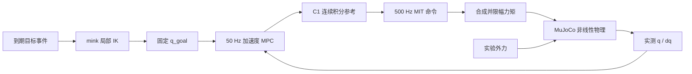

# 00：问题与模块边界

本项目处理随机时刻出现的离散末端位置：同一时刻只有最新目标有效，旧任务不排队。控制路线为“基于 IK 和关节空间线性 MPC 的在线目标跟踪，采用 MIT 形式关节阻抗接口执行”。没有参数辨识、自适应律、鲁棒保证或全局障碍物规划。

IK 输入 world 位置和实测 seed，输出关节终点；MPC 输入实际状态、终点、上一参考边界加速度，输出时间预测；参考生成器把当前预测第一段变为连续的位置及其导数。名义动力学仅生成前馈，MITAdapter 唯一一次计算反馈并写 ctrl。

`robot.py` 集中索引和 FK。`sim.py` 只有初始化会 reset。`disturbances.py` 独占实验外力，不向 IK/MPC/前馈传递计划。`monitor.py` 记录制动、过期和停止。`telemetry.py/analyze.py` 记录与评价。

真实headless物理场景与全部集成测试已通过，GUI自动验证受X11限制，见 [validation](validation.md)。最小实验：`python -m panda_mpc.demo --scenario switch --headless --duration 12`（依赖安装后）。查看 events 的 scheduled/activated/first_command、ticks 的 goal_id、NPZ 的真实速度。错误是把新目标构型直接写入物理状态。练习：画出 0.013 s 事件在 0.02 s tick 消费时，各模块保留和撤销的数据。
