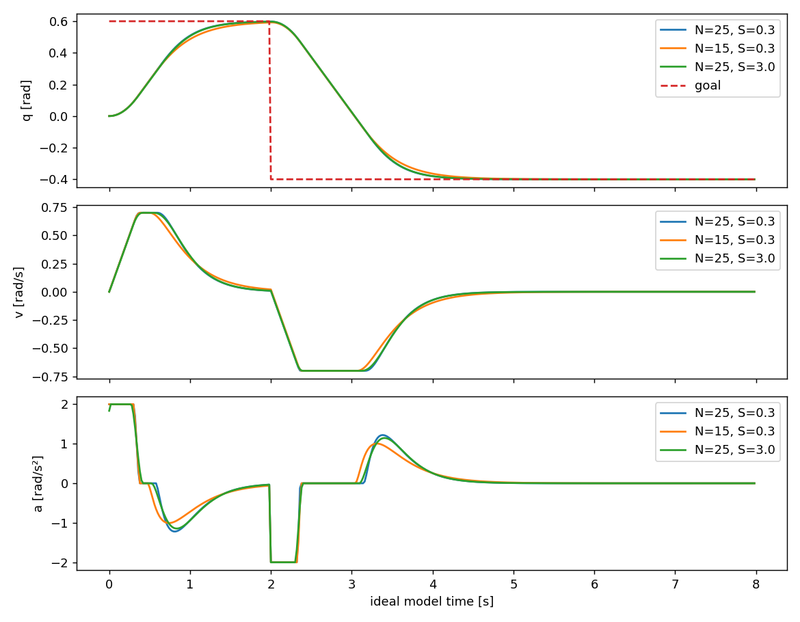

# 08：实验、实测证据和调参

## 已实际完成的离线验证

`python -m pytest -q -ra`：14 passed、7 skipped。详细输出见 [test_results](test_results.txt)。跳过的都需要真实 MuJoCo/mink/Python OSQP，不把这些跳过算通过。

`python scripts/verify_native_osqp.py` 使用本机已有 CasADi3.6.7 + OSQP C0.6.3，调用生产 MPCProblem 构造矩阵，实际执行每组400次滚动优化。初始0、目标0.6 rad、2秒改为-0.4 rad，仿真8秒。每次检查初值和 Gz 硬界，再推进理想双积分。它不调用生产 Python OSQP，也不调用 MuJoCo。

| 模型 | N | S | 末位置误差 rad | 最大输入变化 rad/s² | 求解 P95 ms |
|---|---:|---:|---:|---:|---:|
| 单轴 |25|0.3|3.45e-9|2.000|1.55|
| 七轴 |25|0.3|3.45e-9|2.000|12.29|
| 单轴 |15|0.3|5.79e-7|2.000|0.83|
| 单轴 |25|3.0|1.00e-8|1.965|7.53|

这些是本次机器/包装器运行值，不是性能保证。N15 在该理想案例终点误差略大但都收敛；S增加稍减小最大输入变化，同时求解耗时增加，不能直接推广为所有任务结论。变化代价不是 jerk 硬界。七轴峰值速度0.7 rad/s、加速度2 rad/s²，最大约束违反约3.43e-16；原始数据和时序最大值见 [summary](evidence/native_osqp/summary.json)。

## 真实仿真实验：已实现入口，未通过验收

| 场景 | 计划 | 必查指标 | 当前状态 |
|---|---|---|---|
| hold | home保持10s | 漂移/速度/饱和 | 缺MuJoCo |
| single_target | 0.2s激活[.48,.14,.50] | <1cm、<.02m/s连续.2s，后续保持 | 未测 |
| switch | .2/.7/1.3s的A/B/C | 首命令ID、实际非零速度、无状态赋值 | 未测 |
| random | 固定seed，2~4s间隔 | 拒采原因、按可用时间分类 | 未测 |
| rapid_switch | .3s换目标 | 不排队，不要求每个被抢占目标到达 | 未测 |
| invalid_goal | 1s目标[2,2,2] | 拒绝并制动，退出码2 | 未测 |
| disturbance | 保持目标时外力矩 | 对照差异和恢复 | 未测 |

命令全集见 [README](../README.md)。hold 实际启动因 `ModuleNotFoundError: mujoco` 退出1；安装失败细节见 [install_attempt](install_attempt.log)，没有到达/恢复/饱和计数或末端误差数字。

扰动设置是关节2广义力矩+6 Nm，从4.0s持续0.25s。每步覆盖、撤去清零，不修改状态；控制器不读取计划。使用相同seed/目标表/配置的 `--no-disturbance` 对照，分析 `--compare` 检查除注入开关外配置一致。报告注入前差异、最大偏移、是否超过数值噪声、最大误差、撤去后满足原阈值连续.2s的恢复时间、速度/力矩峰值、饱和/QP失败/降级。

分析不应将恢复效果完全归于 MPC：MIT 自身有反馈，名义前馈也影响跟踪。当前没有未知负载对照或算法排行榜。随机目标 superseded 按可用时间独立分类，不能一律算成功/失败。

调参顺序：先真实 home 和小幅 MIT；再单目标；检查原始力矩/持续饱和；再看 reference_backtracks；最后才改 N/S 和运动要求。禁止通过扩大力矩限幅、改近目标或减小到无意义外力伪造验收。

练习：在完整环境跑 same-seed paired disturbance，先确认外力造成显著真实偏移，再讨论恢复时间及各层贡献。
