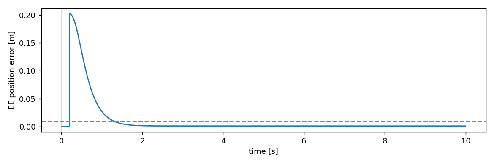
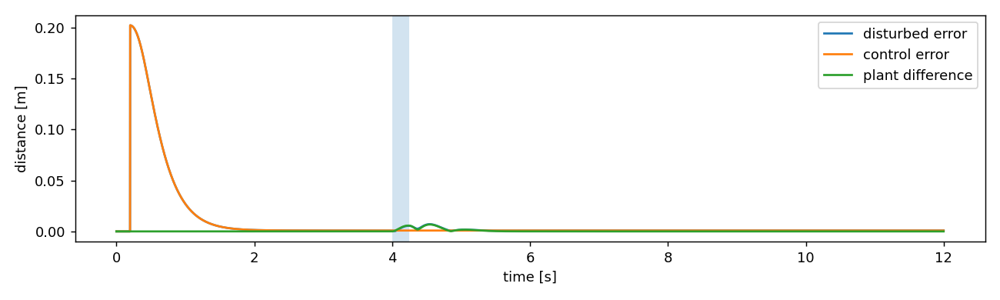

# 当前实际验证记录

日期：2026-10-21。本次处理用户运行中的 SparseConversionWarning，发现并修复真实闭环参考停滞。初始缺包记录保留在 [最初验证记录](validation_initial.md)，已不代表当前依赖状态。

## 修复原因和实现

- mink0.0.13 的 build_ik 构造密集 P/G，qpsolvers 的 OSQP 后端会自动转换并警告。现在仍用 mink 的公开任务、约束和 build_ik，项目内显式转 CSC 后直接调用已安装的 OSQP1.0.4，使用 solve(raise_error=False)。没有过滤或屏蔽警告，没有改第三方代码。
- 用户原运行完整10s、退出0，但末端误差0.171385m、489次参考回退。强制在20ms段内补偿参考与实测的微小位置偏差，将加速度放大后反复制动。现在采用任务允许的等价C1方案：从上一接受参考边界连续积分MPC第一加速度；MPC初值仍是真实测量，完整区间边界/制动/日志保留。公式见 [连续参考](03_online_trajectory.md)。
- OSQP活跃速度界上约3.44e-15的舍入误差被旧版误判为超速。初值判断仅容许1e-10舍入量，x0不裁剪，真实超界仍拒绝。
- demo结束后打印最后目标状态、位置误差、QP失败与饱和数；运行正常退出与目标达到是两个不同事实，未通过到达判据时明确提示。

## 已运行命令和结果

```bash
.venv/bin/python -m pytest -q -W error
.venv/bin/python scripts/acceptance.py
.venv/bin/python -m panda_mpc.demo --scenario single_target --headless --duration 10 --seed 42 --output outputs/fix-reference-probe
```

**22 passed，0 skipped，warnings作为错误也全部通过。** 其中包含真实MuJoCo、mink、OSQP的保持、IK、固定目标、运动途中替换和回放、真实外力对照/恢复、无效目标。另有新增连续积分回归与稀疏转换警告回归。见 [测试输出](test_results.txt)。

验收脚本实际运行了hold10s、single_target10s、switch12s、random30s、rapid_switch10s、invalid_goal8s、disturbance12s和同配置无扰动control12s，然后执行真实对照分析。所有命令及预期退出码检查通过，[原始命令结果](evidence/closed_loop/commands.json)。完整日志位于 outputs/acceptance-20261021-110412/；小量可长期保留的摘要与图位于 docs/evidence/closed_loop/。

| 场景 | 末端最终误差 m | 饱和步 | QP失败 | 参考回退 | 解释 |
|---|---:|---:|---:|---:|---|
| hold |6.42e-15|0|0|0|home保持通过|
| single_target |0.000859|0|0|0|1.636s达到，目标于0.2s激活，之后保持|
| switch |0.001259|0|0|0|A/B/C途中替换|
| random |0.010109|0|0|0|末个目标仍可能在移动，按可用时间分类|
| rapid_switch |0.149497|0|0|0|频繁抢占，不要求每个目标到达|
| invalid_goal |2.842538|0|0|0|这是对不可达目标的误差；明确rejected后制动，退出2|
| disturbance |0.000859|0|0|0|外力撤去后恢复|



扰动为关节2 +6Nm，从4.0s开始持续0.25s；同配置无扰动对照注入前差异0，最大实际末端偏移0.006780m，最大目标误差0.007100m。撤去后0.796s重新满足误差<0.01m、速度<0.02m/s并连续0.2s；饱和/QP失败/降级均0。不能把恢复全部归因于MPC，MIT内反馈也起作用。



单目标整个MPC tick耗时P50=3.415ms、P95=3.506ms、最大11.362ms、20ms超预算0；仿真/控制墙钟比约2.764（统计不包含退出后的绘图时间）。invalid_goal的IK拒绝tick约122ms，超20ms预算1次；本版本不声称所有目标激活都满足墙钟实时。

环境的实际依赖、代码/模型摘要和计时约定见 [metadata](evidence/closed_loop/metadata.json)，各场景完整数值见相邻 *_summary.json。

## GUI验证状态与剩余限制

已尝试原GUI命令。当前工具执行环境无法连接DISPLAY=:1，GLFW返回 X11: Failed to open display :1，因而没有完成这里的GUI验收。用户此前那次GUI运行的日志证明仿真完整跑了10s；按 --duration 10 结束后窗口关闭属于预期行为。用户桌面可继续使用原命令，代码更新无需重新安装editable包。

仍未验证干净环境的完整依赖锁、多个seed的系统回归、严重物理数值异常触发、未知负载实验。位置阈值/目标距离/外力幅值没有为通过测试而修改；无硬件控制、参数自适应、全局避障或形式化安全保证。
